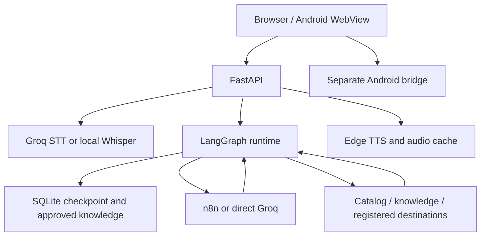

# Architecture

## Active entry points

`main:app` mounts chat, operator management, host pairing, transcription, TTS and the browser assets. `agent_graph.ChatRuntime` is the active conversation runtime.

The Groq tool loop follows commands → model → tools → model → finish, with a finite model-call budget. Direct commands and exact approved Q&A can finish without a model. The n8n provider uses the same checkpointed graph but routes conversational/catalog processing through `prime_engine`; the supplied example workflow is not an exported agent-tool loop.

## Data and state

| Store | Purpose | Public package |
| --- | --- | --- |
| `products.db` | Operator product catalog | Created locally from synthetic JSON for demo |
| `data/agent.db` | Curated knowledge, rooms, skills, proposals and map revision | Created locally |
| `data/chat_graph.db` | LangGraph conversation checkpoints | Created locally |
| `data/agent-admin.key` | Persistent local operator credential | Created locally, never committed |
| `data/agent-people.json` | Greeting identity configuration | Only a fictional example is provided |
| `vision/known_faces` | Face reference samples | Not distributed |

Browser audio is segmented into turns. Groq STT receives bytes in memory. TTS uses progressive playback and a disk cache; the whole application should not be described as entirely diskless. Persistent checkpoint history is not identity authentication or automatic self-training.

## Robot integration

Navigation output is a registered-destination proposal. The WebView bridge dispatches an explicit command when `agentMotionMode()` reports `direct-v2`. Normal browser sessions cannot implement that native bridge. The Android project and vendor SDK are separate; only historical Android files in backup directories were present in the upload, so none were silently promoted into the active source tree.

The host broker pairs one robot session and delivers short-lived recognition greetings or operator speech. It has an acknowledgement/claim flow and a cooldown. Neither greeting recognition nor retrieved model text is a grant to move the robot.
